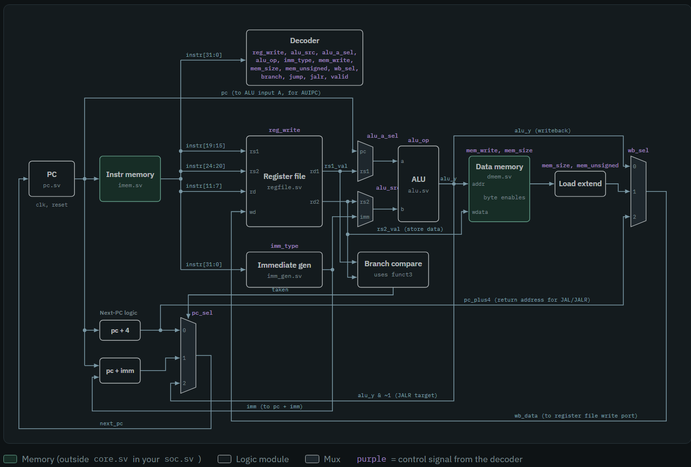
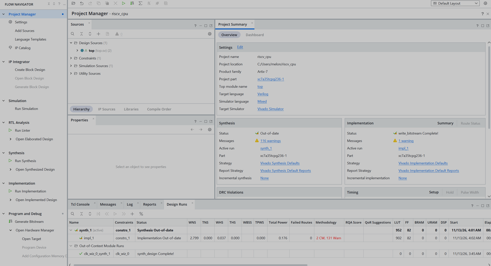

# RV32I RISC-V Processor on FPGA

A 32-bit RISC-V processor designed in SystemVerilog for the Digilent Basys 3. The SoC uses a five-stage pipeline. The single-cycle reference core powered the FPGA demo below.

<!-- Replace with your demo video or GIF -->
## Demo Video
[](https://youtu.be/fxQB4NonvsM)
## Status

- [x] 37 arithmetic, memory, and control-flow instructions from RV32I
- [x] Every module verified with its own self-checking testbench
- [x] Full core verified with test programs (arithmetic, loads/stores, branch loops, JAL/JALR)
- [x] System-on-chip with instruction/data memory and memory-mapped I/O
- [x] Single-cycle build running on a Basys 3 at 50 MHz
- [x] GCC-compiled C firmware with UART and GPIO verified in simulation
- [x] Five-stage pipeline with forwarding, load-use stalls, and branch flushing
- [ ] Official `riscv-tests` (rv32ui) suite
- [ ] FPGA timing and board validation for the pipelined build

## Architecture

`core_pipeline.sv` overlaps Fetch, Decode, Execute, Memory, and Writeback. Execute forwards operands and resolves branches and jumps. A load-use dependency stalls Fetch and Decode for one cycle. A redirect flushes both younger instructions.



In the single-cycle reference diagram, purple labels show decoder control signals. The green instruction and data memories live outside the core in `soc.sv`.

| Module | Description |
| --- | --- |
| `pc.sv` | Program counter with synchronous reset |
| `imem.sv` | Instruction memory, loaded from a `.hex` file |
| `decoder.sv` | Decodes opcode/funct3/funct7 into all datapath control signals, with illegal-instruction detection |
| `regfile.sv` | 32 × 32-bit register file, two combinational read ports, one write port, `x0` hardwired to zero |
| `imm_gen.sv` | Immediate generator for the I, S, B, U and J formats, with sign extension |
| `alu.sv` | 11-operation ALU (ADD, SUB, AND, OR, XOR, SLL, SRL, SRA, SLT, SLTU, pass-through for LUI) |
| `branch_comp.sv` | Compares rs1/rs2 for BEQ, BNE, BLT, BGE, BLTU, BGEU |
| `dmem.sv` | Data memory with byte enables for SB/SH/SW |
| `core.sv` | Single-cycle reference core |
| `core_pipeline.sv` | Five-stage core used by the SoC |
| `soc.sv` | Core + memories + memory-mapped I/O |
| `top.sv` | Basys 3 top level: clocking wizard, reset and switch synchronizers |
| `cpu_package.sv` | Shared constants (ALU ops, immediate formats, writeback select) used by every module |

<!-- Rename the files above to match yours exactly -->

### Memory-mapped I/O

| Address | Device | Access |
| --- | --- | --- |
| `0x1000_000C` | LEDs (16 bits, byte-enable aware) | write |
| `0x1000_0010` | Switches (16 bits) | read |
| `0x1000_0014` | UART TX (low byte, writes while busy ignored) | write |
| `0x1000_0018` | UART status (bit 0: busy) | read |

The CPU talks to hardware with ordinary `lw`/`sw` instructions; `soc.sv` decodes the address and routes the access to memory or to the device.

UART transmit uses 115200 baud, 8 data bits, no parity, one stop bit at the
50 MHz CPU clock (434 clocks per bit). Include `uart.h` from `sw/main.c` and
call `uart_putc('H')` for a character or `uart_puts("Hi\r\n")` for a string.
The driver polls UART status before sending each byte. The CPU reads string
literals from the read-only ROM window at `0x00002000`–`0x00002FFF`.
The `uart_tx` output is exposed through `top.sv` and mapped to pin A18 by
`Basys-3-Master.xdc` for the USB-UART connection. Update your Vivado constraints
to include that line before generating a hardware bitstream.
Run `python scripts/regress.py uart` to test the transmitter and SoC integration.

## Verification

Every module has a self-checking testbench in `tb/` that reports pass/fail. Tests target the edge cases where bugs hide:

- Signed vs unsigned comparison (`SLT` vs `SLTU`, `BLT` vs `BLTU`)
- Arithmetic vs logical shifts, and shift amounts above 31
- Sign extension for every immediate format
- `x0` staying zero after writes
- Byte and halfword stores only changing the selected bytes
- `JALR` clearing the lowest bit of its target

The full-core testbench runs programs and prints a commit log (PC, instruction, register written) for debugging, with waveforms viewed in GTKWave.

## Single-cycle FPGA results (Basys 3, Artix-7 XC7A35T)

| Metric | Value |
| --- | --- |
| Clock | 50 MHz (Clocking Wizard from the 100 MHz board clock) |
| Timing | Met, WNS +2.8 ns |
| LUTs | 902 (~4% of the device) |
| Flip-flops | 82 |



At 100 MHz the single-cycle design failed timing by 2.66 ns. Its critical path through register read, ALU, memory, and writeback was about 12.7 ns. FPGA timing for the pipelined build is pending.

Inputs from the board (reset button, switches) pass through two-flip-flop synchronizers, and reset is asserted asynchronously and released synchronously.

## Running the Simulations

Instruction memory loads `sw/prog.hex` by default. Build it with `make -C sw`
using the RISC-V toolchain, then run simulations from the repository root.
The `INIT_FILE` parameter on `top`, `soc`, or `imem` selects another program file.
Unused instruction words are initialized to NOPs. The instruction memory holds
1024 words (4 KB); the hex file must fit in that space.

Run `python scripts/regress.py` from the repository root. The firmware test uses
the checked-in `sw/prog.hex`. The other SoC tests use dedicated images in
`programs/`. For Vivado, add the selected hex file as a memory initialization
source and set the `top` parameter `INIT_FILE` to a path that resolves during
synthesis. Rebuild the bitstream after changing the firmware image.

Requires [Icarus Verilog](https://bleyer.org/icarus/) and GTKWave.

## Running C Programs

C code in `sw/` is compiled with the RISC-V GCC toolchain into RV32I machine code and loaded into instruction memory.

```bash
cd sw
make          # main.c → prog.elf → prog.bin → prog.hex
make dump     # view the generated assembly
```

`crt0.S` sets up the stack, copies `.data` from ROM to RAM, and clears `.bss`
before calling `main()`. The linker places code at address 0 and packs `.rodata`
and the `.data` initializers in the same 4 KB ROM image. Run
`python scripts/regress.py program -v` from the repository root to verify cold
boot and warm reset, `Hi` over UART, and inverted switch values on the LEDs.
When changing the demo behavior, update the expectations in `tb/program_tb.sv`.

```bash
# ALU testbench
iverilog -g2012 -o alu_sim rtl/cpu_package.sv rtl/alu.sv tb/alu_tb.sv
vvp alu_sim

# Full core
iverilog -g2012 -o core_sim rtl/*.sv tb/core_tb.sv
vvp core_sim
gtkwave core.vcd
```


## Building for the Basys 3

1. Create a Vivado project for part `xc7a35tcpg236-1`.
2. Add the files in `rtl/`, the program `.hex` file, and `Basys-3-Master.xdc`.
3. Add a Clocking Wizard IP (`clk_wiz_0`): 100 MHz in, 50 MHz out.
4. Set `top` as the top module, generate the bitstream, and program the board.

## Repository Layout

```
rtl/          SystemVerilog design files
tb/           Testbenches
programs/     Test programs (.hex)
sw/           Bare-metal C firmware and build tools
docs/         Diagrams and results
```

## Next Steps

- Pass the official `riscv-tests` rv32ui suite
- Verify pipelined FPGA timing and run the firmware demo on the Basys 3
