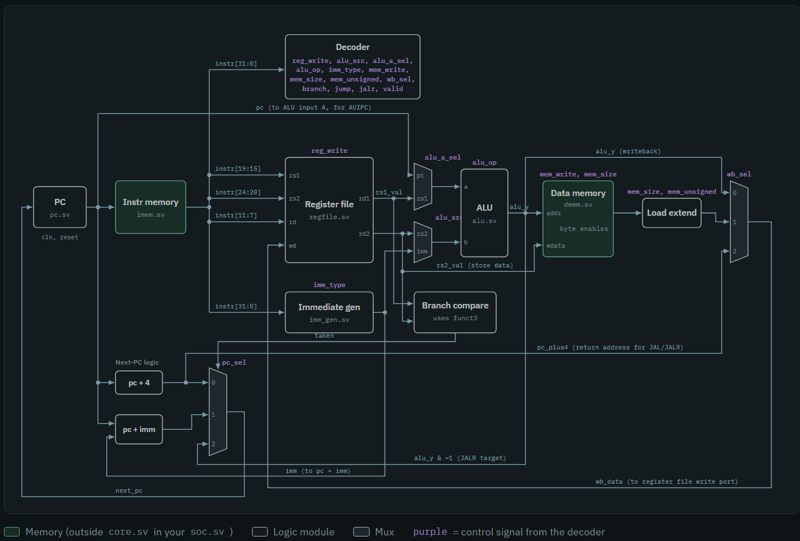
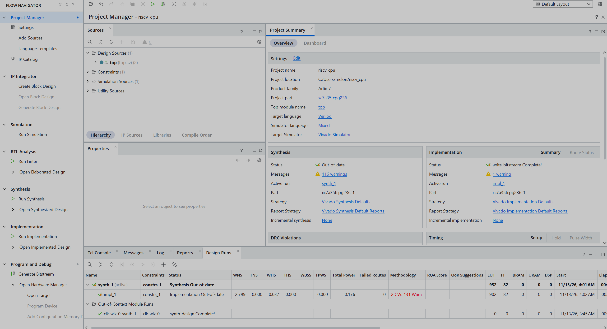

# RV32I RISC-V Processor on FPGA

A single-cycle 32-bit RISC-V (RV32I) processor designed from scratch in SystemVerilog, verified in simulation with self-checking testbenches, and deployed on a Xilinx Artix-7 FPGA (Digilent Basys 3).

<!-- Replace with your demo video or GIF -->
**Demo:** [Video of the CPU running on the Basys 3](LINK-TO-VIDEO)

## Status

- [x] All 37 RV32I base integer instructions implemented
- [x] Every module verified with its own self-checking testbench
- [x] Full core verified with test programs (arithmetic, loads/stores, branch loops, JAL/JALR)
- [x] System-on-chip with instruction/data memory and memory-mapped I/O
- [x] Running on a Basys 3 at 50 MHz
- [ ] RISC-V GCC toolchain: C programs running on the CPU
- [ ] Official `riscv-tests` (rv32ui) suite
- [ ] UART output ("Hello, RISC-V!")
- [ ] 5-stage pipeline with forwarding and hazard detection

## Architecture



Each instruction completes in one clock cycle: fetch, decode, execute, memory access and writeback. Purple labels are control signals from the decoder; the green blocks (instruction and data memory) live outside the core in `soc.sv`.

| Module | Description |
| --- | --- |
| `pc.sv` | Program counter with synchronous reset |
| `imem.sv` | Instruction memory, loaded from a `.hex` file |
| `decoder.sv` | Decodes opcode/funct3/funct7 into all datapath control signals, with illegal-instruction detection |
| `regfile.sv` | 32 × 32-bit register file, two combinational read ports, one write port, `x0` hardwired to zero |
| `imm_gen.sv` | Immediate generator for the I, S, B, U and J formats, with sign extension |
| `alu.sv` | 11-operation ALU (ADD, SUB, AND, OR, XOR, SLL, SRL, SRA, SLT, SLTU, pass-through for LUI) |
| `branch_unit.sv` | Compares rs1/rs2 for BEQ, BNE, BLT, BGE, BLTU, BGEU |
| `dmem.sv` | Data memory with byte enables for SB/SH/SW |
| `core.sv` | Connects the modules; next-PC logic, ALU input muxes, load sign/zero extension, writeback mux |
| `soc.sv` | Core + memories + memory-mapped I/O |
| `top.sv` | Basys 3 top level: clocking wizard, reset and switch synchronizers |
| `cpu_package.sv` | Shared constants (ALU ops, immediate formats, writeback select) used by every module |

<!-- Rename the files above to match yours exactly -->

### Memory-mapped I/O

| Address | Device | Access |
| --- | --- | --- |
| `0x1000_000C` | LEDs (16 bits, byte-enable aware) | write |
| `0x1000_0010` | Switches (16 bits) | read |

The CPU talks to hardware with ordinary `lw`/`sw` instructions; `soc.sv` decodes the address and routes the access to memory or to the device.

## Verification

Every module has a self-checking testbench in `tb/` that reports pass/fail. Tests target the edge cases where bugs hide:

- Signed vs unsigned comparison (`SLT` vs `SLTU`, `BLT` vs `BLTU`)
- Arithmetic vs logical shifts, and shift amounts above 31
- Sign extension for every immediate format
- `x0` staying zero after writes
- Byte and halfword stores only changing the selected bytes
- `JALR` clearing the lowest bit of its target

The full-core testbench runs programs and prints a commit log (PC, instruction, register written) for debugging, with waveforms viewed in GTKWave.

## FPGA Results (Basys 3, Artix-7 XC7A35T)

| Metric | Value |
| --- | --- |
| Clock | 50 MHz (Clocking Wizard from the 100 MHz board clock) |
| Timing | Met, WNS +2.8 ns |
| LUTs | 902 (~4% of the device) |
| Flip-flops | 82 |



At 100 MHz the design failed timing by 2.66 ns: the single-cycle critical path (register read → ALU → memory → writeback) is about 12.7 ns, limiting this design to roughly 79 MHz. Pipelining is the planned fix.

Inputs from the board (reset button, switches) pass through two-flip-flop synchronizers, and reset is asserted asynchronously and released synchronously.

## Running the Simulations

Requires [Icarus Verilog](https://bleyer.org/icarus/) and GTKWave.

```bash
# ALU testbench
iverilog -g2012 -o alu_sim rtl/cpu_package.sv rtl/alu.sv tb/alu_tb.sv
vvp alu_sim

# Full core
iverilog -g2012 -o core_sim rtl/*.sv tb/core_tb.sv
vvp core_sim
gtkwave core.vcd
```

<!-- Adjust the paths and file names to match your repo -->

## Building for the Basys 3

1. Create a Vivado project for part `xc7a35tcpg236-1`.
2. Add the files in `rtl/`, the program `.hex` file, and `constraints/basys3.xdc`.
3. Add a Clocking Wizard IP (`clk_wiz_0`): 100 MHz in, 50 MHz out.
4. Set `top` as the top module, generate the bitstream, and program the board.

## Repository Layout

```
rtl/          SystemVerilog design files
tb/           Testbenches
programs/     Test programs (.hex)
constraints/  Basys 3 pin constraints
docs/         Diagrams and results
```

## Next Steps

- Compile C programs for the CPU with the RISC-V GCC toolchain
- Pass the official `riscv-tests` rv32ui suite
- UART transmitter for text output
- 5-stage pipeline with forwarding, load-use stalls and branch flushing
